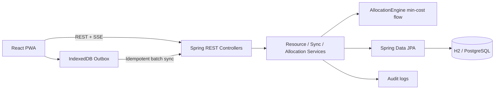

# Architecture

## Optimization objective
For each stock item and its resource category, construct a directed capacitated network:
`source -> volunteer.in -> volunteer.out -> request -> sink`.
The stock item bounds source flow. Each volunteer's `in -> out` arc bounds *remaining carrying capacity*; capacities are updated between stock runs, so they cannot be used twice. Request-to-sink edges have unit capacity and declining marginal utility.

The successive-shortest-augmenting-path algorithm minimizes:

`Σ delivered_units [2 × (distance(stock, volunteer) + distance(volunteer, request)) − 100 × urgency − 35 × underserved_indicator − 30 × (1 − already_allocated/request_quantity)]`

Only negative-cost augmenting paths are selected. Distances are great-circle kilometers, not real street routes. The fairness term is a *soft bonus*; it is not a guaranteed max-min fairness constraint. Since network flow is optimized **separately per stock**, the method is an operational heuristic across all stocks, not a proof of global cost optimality. Reverse residual arcs permit reallocating units within each stock network. The baseline is a first-come-first-served heuristic using nearest carrier per supply and request.

## Transactions and duplicate prevention
Plans are proposed with `PENDING` lines and consume **zero stock**. Admin `approve` locks the plan, stock rows, volunteer rows and request rows; the transaction validates all quantities and reserves every approved unit atomically, rolling back on conflict. Repeated approvals are rejected. Assignment uniqueness is enforced per `(plan_id, request_id, stock_id, volunteer_id)`.

Offline outbox entries are persisted in IndexedDB before POST. Each entry has a UUID. Server uses a unique sync key and SHA-256 hash over a canonical request payload. Identical key+payload yields `REPLAY`, same key+different payload yields `CONFLICT` without overwriting data. Each sync item uses a `REQUIRES_NEW` transaction via a separate service proxy. Network errors preserve queued records. The client stores conflicts for manual dismissal; it does not silently change a conflicted request.

## Known MVP limits
This is **single-instance, local-admin-key demo software**; the example admin secret is not safe for public deployment. SSE is in-memory, so it does not broadcast across replicas. Optimizer uses approximate geodesic distances, does not route over roads, does not model delivery time windows/vehicle tours, and its fairness heuristic is not legally or operationally validated. No production authentication, TLS, user-role enforcement, rate limiting, data retention policy, or monitoring stack are included. Do not use as actual emergency dispatch software.
